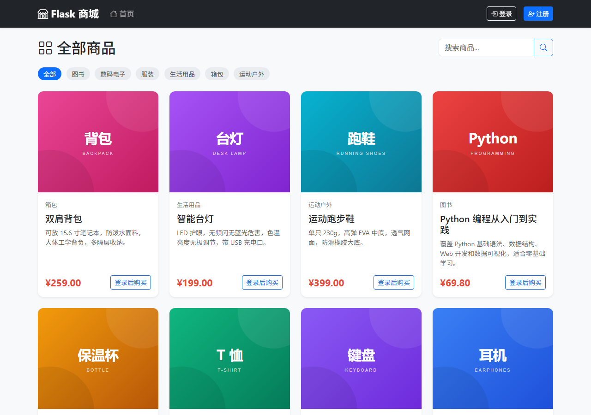
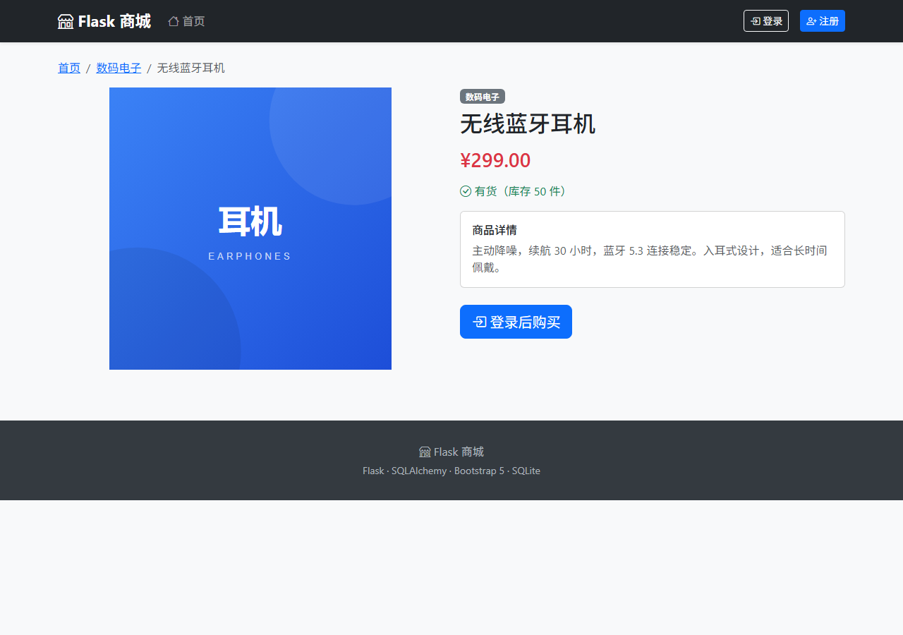

# Flask 商城

一个用 Flask 写的电商网站示例：用户注册登录、商品浏览、购物车、下单、订单查询，外加一个商品和订单的管理后台。后端纯 Python，前端 Bootstrap 5，数据存在 SQLite 里，装好依赖就能跑。



## 功能

- 商品列表：分类筛选、按名称搜索
- 商品详情：价格、库存、描述
- 用户体系：注册、登录、退出，密码加盐哈希存储
- 购物车：加购、改数量、移除，数量不会超过库存
- 下单：生成订单、扣减库存、清空购物车，可查看历史订单
- 管理后台：商品增删改、上下架、订单状态流转



## 技术栈

- Python 3.10+（开发时用的是 3.14）
- Flask 3.1 / Flask-SQLAlchemy / Flask-Login / Flask-WTF
- SQLite
- Bootstrap 5 + Bootstrap Icons + Jinja2

## 运行

```bash
python -m venv .venv
```

Windows：

```bash
.venv\Scripts\activate
```

macOS / Linux：

```bash
source .venv/bin/activate
```

然后：

```bash
pip install -r requirements.txt
python run.py
```

打开 <http://127.0.0.1:5000>。

第一次启动会自动建表，并写入 8 个示例商品。管理员账号是 `admin` / `admin123`，只用于本地演示，实际使用前请改掉。

## 配置

复制 `.env.example` 为 `.env`，按需修改：

| 变量 | 默认值 | 说明 |
|---|---|---|
| `SECRET_KEY` | `dev-only-secret` | session 和 CSRF 签名密钥，部署时务必更换 |
| `DATABASE_URL` | `sqlite:///shop.db` | 相对路径会落在 `instance/` 目录 |
| `FLASK_DEBUG` | `1` | 设为 `0` 关闭调试模式 |
| `PORT` | `5000` | 监听端口 |
| `ADMIN_PASSWORD` | `admin123` | 只在首次写入示例数据时生效 |

想清空数据，删掉 `instance/shop.db` 后重新启动即可。

## 测试

```bash
pip install -r requirements-dev.txt
pytest
```

覆盖注册登录、登录跳转校验、购物车库存上限、下单扣库存、库存不足拦截、后台权限和商品删除后的订单历史。

## 目录结构

```
flask-shop/
├── app/
│   ├── __init__.py        # 应用工厂
│   ├── extensions.py      # db / login_manager / csrf
│   ├── models.py          # User、Product、CartItem、Order、OrderItem
│   ├── forms.py           # WTForms 表单
│   ├── auth.py            # 注册、登录、退出
│   ├── shop.py            # 商品、购物车、结算、订单
│   ├── admin.py           # 管理后台
│   ├── seed.py            # 示例数据
│   ├── static/
│   └── templates/
├── tests/
├── docs/screenshots/
├── run.py
├── requirements.txt
└── requirements-dev.txt
```

## 几点实现说明

- 全站启用 `CSRFProtect`，所有 POST 表单都带 token，不只是 WTForms 渲染的那几个。
- 登录后的 `next` 参数只接受站内路径，避免被人拿来做跳转钓鱼。
- 金额用 `Numeric(10, 2)` 存，不用浮点数。
- 下单前会重新核对库存，防止购物车里的数量和当前库存对不上。
- 订单明细冗余保存商品名和单价，商品删除后历史订单仍然完整（`product_id` 置空）。
- SQLite 默认不校验外键，连接时手动打开了 `PRAGMA foreign_keys`。

## 已知限制

- SQLite + 单进程，适合演示和学习，不适合直接上生产。
- 没有接入支付，订单状态由管理员手动修改。
- 没有图片上传，商品图填 URL；示例图是 `static/images` 下的本地 SVG。
- 商品列表没有分页，数据量大时需要补。

## License

MIT
